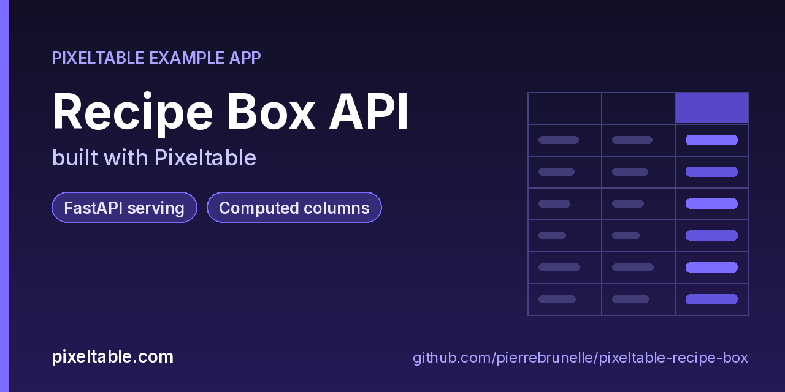

<!-- pixeltable-example-app: 20260923-recipe-box -->
# Recipe Box API built with Pixeltable



[](https://codespaces.new/pierrebrunelle/pixeltable-recipe-box?quickstart=1)
[](https://pixeltable.com)
[](https://pypi.org/project/pixeltable/)
[](https://github.com/pixeltable/pixeltable)
[](LICENSE)

A recipe box with a REST API: store a recipe's title, ingredient list, cooking time and notes, and Pixeltable maintains the ingredient count, a display title and a short teaser as **computed columns**. A `@pxt.query` finds quick recipes under a time budget, and a compute route counts ingredients for a draft recipe before you save it.

[Pixeltable](https://pixeltable.com) is open-source, Python-native **multimodal AI data infrastructure**: tables, incremental computed columns, UDFs, indexes and serving in one library, running locally or on Pixeltable Cloud.

> ⭐ **Like this example?** Star [pixeltable/pixeltable](https://github.com/pixeltable/pixeltable) on GitHub. It helps other developers find it.

## What this example shows

- **FastAPI serving**: one `FastAPIRouter` turns tables and `@pxt.query` functions into typed REST routes (insert, update, delete, compute and query) with OpenAPI docs
- **Incremental computed columns** powered by plain Python UDFs (`@pxt.udf`)
- **Importable UDF module**: UDFs live in `udfs.py`; tables, queries and routes live together in `app.py` (Pixeltable resolves UDFs by module path)
- **`pixeltable.toml`** declares a local database and a **Pixeltable Cloud** database, so the same code deploys with `pxt db update`

## Things to try

- Change a recipe's `ingredients` with `POST /recipes/update` and watch `n_ingredients` change in the response. Pixeltable recomputes only the dependent column.
- Call `GET /recipes/quick?max_minutes=20` for weeknight dinners; the filter and sort are a Pixeltable query, not Python loops.
- Run `pxt rows recipes/recipes -n 5` to look at the stored table, computed columns included.

## What's inside

| File | What it is |
|------|------------|
| `.devcontainer/devcontainer.json` | GitHub Codespaces / Dev Container config: Python 3.12, installs `requirements.txt`, forwards port 8000 |
| `.github/social-preview.png` | Social preview image (1280x640) |
| `CITATION.cff` | Citation metadata (authors, license, release date, keywords) |
| `app.py` | The app: tables declared as Python classes, `@pxt.query` functions, and the `FastAPIRouter` routes |
| `client_demo.py` | Count ingredients, save and edit a recipe, and search quick meals through the API |
| `pixeltable.toml` | Project config: the local database plus a Pixeltable Cloud database (sizing, deploy excludes) |
| `seed.py` | Seed a few recipes |
| `udfs.py` | Pixeltable UDFs (`@pxt.udf`) in their own importable module, imported by `app.py` |
| `requirements.txt` / `pyproject.toml` | Dependencies (`pixeltable[serve]>=0.7.14`) |

**Tables**

| Table | Stored columns | Computed columns |
|-------|---------|------------------|
| `recipes` | `title`, `ingredients`, `minutes`, `notes` | `id`, `n_ingredients`, `title_upper`, `title_blurb` |

**API routes** (service `recipes_api`)

| Method | Path | Kind | Backed by | Notes |
|--------|------|------|-----------|-------|
| `POST` | `/recipes` | insert | `Recipes` |  |
| `POST` | `/recipes/update` | update | `Recipes` |  |
| `POST` | `/ingredient-count` | compute | `Recipes` |  |
| `GET` | `/recipes/quick` | query | `quick_recipes` |  |

## Run in your browser (GitHub Codespaces)

[](https://codespaces.new/pierrebrunelle/pixeltable-recipe-box?quickstart=1)

1. Click **Open in GitHub Codespaces** above (or [this link](https://codespaces.new/pierrebrunelle/pixeltable-recipe-box?quickstart=1)). The dev container installs Python 3.12 and `pixeltable[serve]>=0.7.14` from `requirements.txt`.
2. In the codespace terminal, create the tables, seed them and start the API:

   ```bash
   pxt schema update app.py recipes
   python seed.py recipes
   pxt service run app.py recipes --port 8000   # open http://localhost:8000/docs
   python client_demo.py                       # in another terminal
   ```

3. Codespaces forwards port 8000: open it from the **Ports** tab (or the pop-up) and add `/docs` to the URL for the interactive OpenAPI docs.

## Quickstart

Requires Python 3.11+ and `pixeltable[serve]>=0.7.14`.

```bash
git clone https://github.com/pierrebrunelle/pixeltable-recipe-box.git
cd pixeltable-recipe-box
python -m venv .venv && source .venv/bin/activate
pip install -r requirements.txt

# Create the tables in a local catalog directory named `recipes`
pxt schema update app.py recipes

python seed.py recipes
pxt service run app.py recipes --port 8000   # open http://localhost:8000/docs
python client_demo.py                       # in another terminal
```

Try it:

```bash
curl -s -X POST localhost:8000/ingredient-count -H 'Content-Type: application/json' -d '{"ingredients": "flour, butter, sugar"}'
curl -s 'localhost:8000/recipes/quick?max_minutes=20'
```

## Deploy to Pixeltable Cloud

The same `app.py` runs on [Pixeltable Cloud](https://pixeltable.com). Sign in (or get a free trial database with `pxt new`), point the second database entry in `pixeltable.toml` at your own database, then deploy:

```bash
pxt login                       # or: export PIXELTABLE_API_KEY=<your-api-key>
# edit pixeltable.toml: name = 'pxt://<your-org>:<your-db>'
pxt db update pxt://<your-org>:<your-db>                 # build the image and upload the project
pxt schema update app.py pxt://<your-org>:<your-db>/recipes   # create the tables in the hosted database
pxt service update app.py pxt://<your-org>:<your-db>/recipes  # start the API there
pxt service list pxt://<your-org>:<your-db>              # list hosted services
```

Hosted routes require an API key: send it in the `X-api-key` header (for example `-H "X-api-key: $PIXELTABLE_API_KEY"`). Keep keys in environment variables or `pxt secret set`, never in code.

## Code walkthrough

**1. Business logic is plain Python, in `udfs.py`.** A `@pxt.udf` function can be used as a column expression. Pixeltable records UDFs by module path (`udfs.ingredient_count`), so they live in their own importable module rather than inline in the app: the daemon, serving workers and Pixeltable Cloud import it again by that path.

```python
# udfs.py
@pxt.udf
def ingredient_count(ingredients: str | None) -> int:
    """Ingredients are one per line or comma-separated."""
    raw = (ingredients or '').replace('\n', ',')
    return len([i for i in raw.split(',') if i.strip()])
```

**2. Tables are Python classes (`app.py`).** Annotated attributes are stored columns; attributes assigned an expression are **computed columns** (`id`, `n_ingredients`, `title_upper`, `title_blurb`), evaluated incrementally on every insert or update and recomputed when their inputs change.

```python
# app.py
class Recipes(TableModel, name='recipes'):
    id = pxt.Column(value=pxtf.uuid.uuid7(), primary_key=True)
    title: pxt.String
    ingredients: pxt.String
    minutes: pxt.Int | None
    notes: pxt.String | None

    n_ingredients = ingredient_count(ingredients)
    title_upper = pxtf.string.upper(title)
    title_blurb = teaser(title, minutes)
```

**3. Queries are functions (`app.py`).** `@pxt.query` wraps a Pixeltable query so it can be called from Python or exposed as a route:

```python
# app.py
@pxt.query
def quick_recipes(max_minutes: int):
    """Recipes that fit a time budget, fastest first."""
    return Recipes.where(Recipes.minutes <= max_minutes).select(
        Recipes.id, Recipes.title_blurb, Recipes.n_ingredients
    ).order_by(Recipes.minutes)
```

**4. One router, a full REST API.** `FastAPIRouter` generates request/response models from the column types, validates input, and publishes OpenAPI docs at `/docs`:

```python
# app.py
recipes_api = FastAPIRouter(name='recipes_api')
recipes_api.add_insert_route(
    Recipes, path='/recipes',
    inputs=[Recipes.title, Recipes.ingredients, Recipes.minutes, Recipes.notes],
    outputs=[Recipes.id, Recipes.n_ingredients, Recipes.title_upper, Recipes.title_blurb],
)
recipes_api.add_update_route(
    Recipes, path='/recipes/update',
    inputs=[Recipes.title, Recipes.ingredients, Recipes.minutes, Recipes.notes],
    outputs=[Recipes.id, Recipes.n_ingredients, Recipes.title_upper, Recipes.title_blurb],
)
recipes_api.add_compute_route(Recipes, path='/ingredient-count', inputs=[Recipes.ingredients],
                              outputs=[Recipes.n_ingredients])
recipes_api.add_query_route(path='/recipes/quick', query=quick_recipes, method='get')
```

## Learn more

- 🌐 Website: https://pixeltable.com
- 📚 Docs: https://docs.pixeltable.com
- 💻 Source: https://github.com/pixeltable/pixeltable (⭐ star it if Pixeltable is useful to you)
- 📦 PyPI: https://pypi.org/project/pixeltable/
- 🧩 More example apps: https://pierrebrunelle.github.io/awesome-pixeltable-apps/

**[More Pixeltable example apps →](https://pierrebrunelle.github.io/awesome-pixeltable-apps/)**

---

<sub>Built as part of a daily series of Pixeltable example apps · Pixeltable 0.7.14 · Python, FastAPI, incremental computed columns · Licensed under Apache-2.0.</sub>
